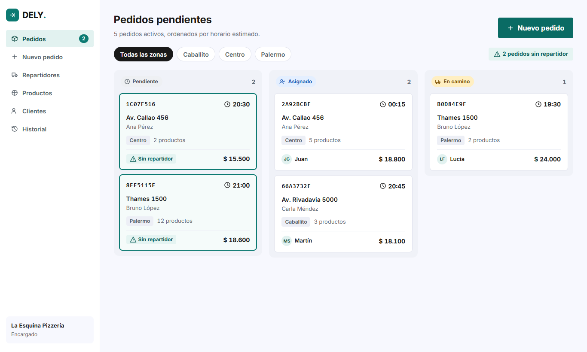
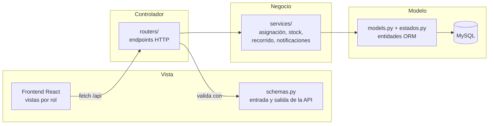
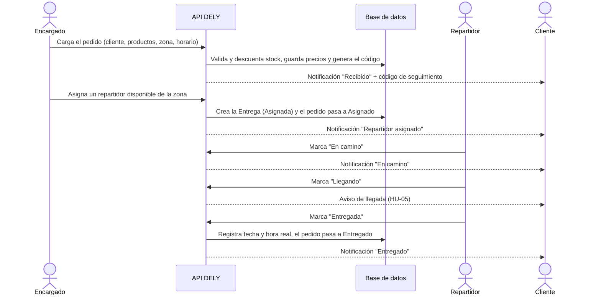
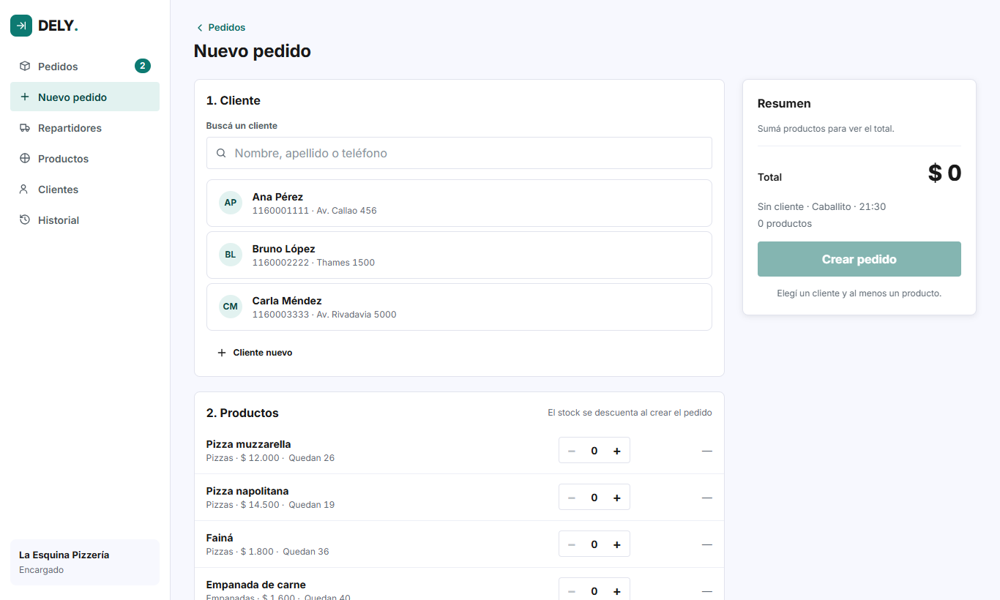
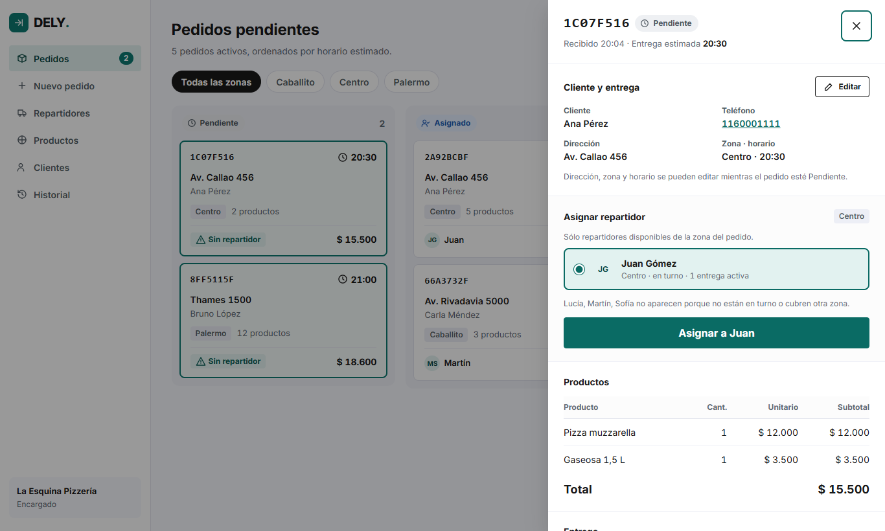
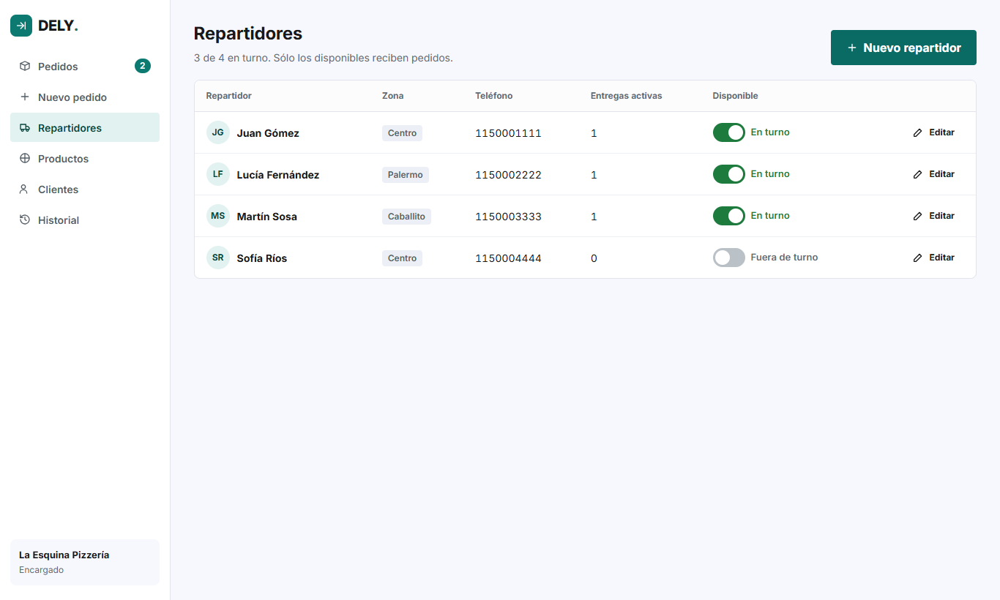
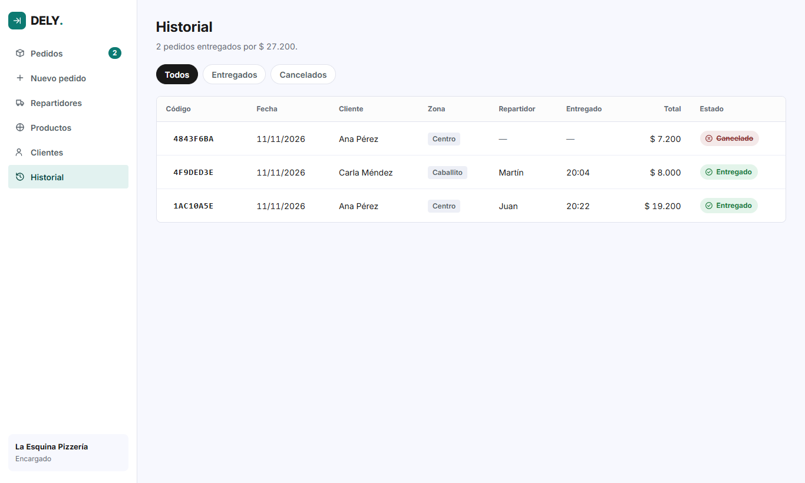
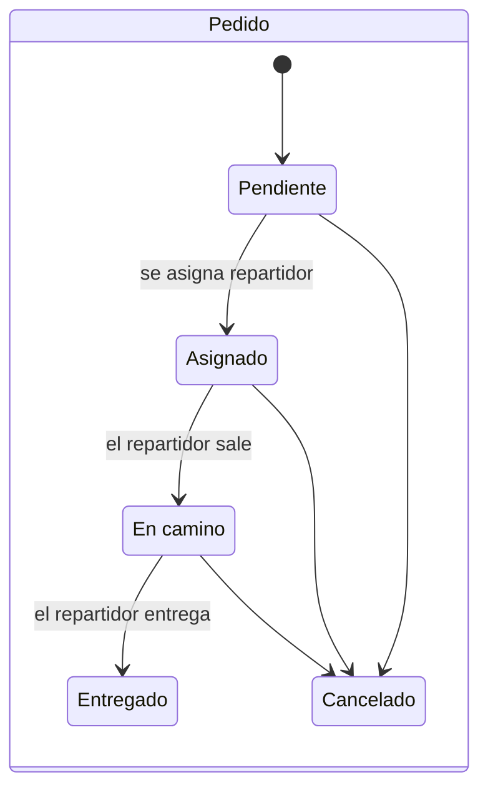
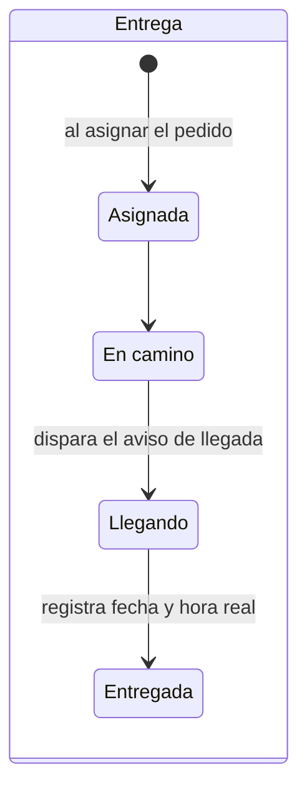

# DELY

[](https://github.com/valenayelen17/Dely/actions/workflows/ci.yml)

Sistema de gestión de entregas de última milla para comercios con repartidores propios. Centraliza los pedidos, los asigna a repartidores por zona, sigue el recorrido de cada entrega y le avisa al cliente en qué estado está su pedido.

Trabajo práctico de Análisis y Metodologías de Sistemas. Integrantes: Marco Passador y Valentina Ayelén De Jesús.



## Contenido

- [Estructura del repositorio](#estructura-del-repositorio)
- [Tecnologías](#tecnologías)
- [Cómo ejecutarlo](#cómo-ejecutarlo)
- [Arquitectura MVC](#arquitectura-mvc)
- [Historias de usuario](#historias-de-usuario)
- [Flujos del sistema](#flujos-del-sistema)
- [Estados del pedido y de la entrega](#estados-del-pedido-y-de-la-entrega)
- [Decisiones respecto del diseño del TP1](#decisiones-respecto-del-diseño-del-tp1)
- [Versionado](#versionado)

## Estructura del repositorio

```
Dely/
├── backend/        API REST (FastAPI + SQLAlchemy + MySQL)
├── frontend/       Interfaz web (React + TypeScript + Vite)
├── docs/capturas/  Capturas de pantalla usadas en este README
└── .github/        CI: tests del backend, lint y build del frontend
```

## Tecnologías

| Parte | Stack |
|---|---|
| Backend | Python 3.11+, FastAPI, SQLAlchemy 2, MySQL (PyMySQL), Pydantic, pytest |
| Frontend | React 19, TypeScript, Vite, React Router |
| Calidad | GitHub Actions: `pytest` en el backend, `oxlint` y build en el frontend |

## Cómo ejecutarlo

### Primera vez

```powershell
# Backend
cd backend
py -m venv .venv
.\.venv\Scripts\python.exe -m pip install -r requirements-dev.txt
Copy-Item .env.example .env          # configurar DATABASE_URL con la cuenta de MySQL
.\.venv\Scripts\python.exe seed.py   # opcional: carga datos de demo

# Frontend
cd ..\frontend
npm install
```

La base y las tablas se crean solas al iniciar la API. Para probar sin MySQL se puede usar SQLite poniendo `DATABASE_URL=sqlite:///./dely.db` en el `.env`.

### Día a día (dos terminales)

```powershell
# 1. Backend: http://127.0.0.1:8000 (documentación interactiva en /docs)
cd backend
.\.venv\Scripts\python.exe -m uvicorn api:app --reload

# 2. Frontend: http://localhost:5173
cd frontend
npm run dev
```

Para la demo conviene abrir tres ventanas: <http://localhost:5173/comercio>, <http://localhost:5173/repartidor> y <http://localhost:5173/seguimiento>. Las pantallas de pedidos, entregas y seguimiento se refrescan cada 5 segundos, así que los cambios de un rol se ven en vivo en los otros.

Más detalle (endpoints, tests, estructura del front) en [backend/README.md](backend/README.md) y [frontend/README.md](frontend/README.md).

## Arquitectura MVC



| Capa | Archivos | Rol |
|---|---|---|
| Modelo | `models.py`, `estados.py`, `database.py` | Entidades del DER, estados y conexión a la base |
| Vista | `frontend/`, `schemas.py` | Lo que ve cada usuario y qué datos entran y salen de la API |
| Controlador | `routers/` | Reciben el pedido HTTP y delegan en los servicios |
| Reglas de negocio | `services/` | Asignación por zona, recorrido de la entrega, stock, notificaciones y seguimiento |

`errores.py` traduce los errores de negocio a respuestas HTTP: 404 si no existe, 409 si hay un conflicto de estado y 422 si los datos no son válidos.

## Historias de usuario

| HU | Historia | Cómo se resuelve |
|---|---|---|
| HU-01 | Como encargado quiero ver los pedidos no entregados | Tablero de pendientes. `GET /api/pedidos/pendientes`, con cliente, productos, total y repartidor |
| HU-02 | Como encargado quiero asignar cada pedido a un repartidor disponible | Panel del pedido. `GET /api/repartidores/?zona=&disponible=true` y `PATCH /api/pedidos/{id}/asignar` |
| HU-03 | Como cliente quiero saber en qué estado está mi pedido | Pantalla de seguimiento. `GET /api/seguimiento/{codigo}`, con estado y horario estimado |
| HU-04 | Como repartidor quiero actualizar el estado de mi entrega | Vista del repartidor. `GET /api/repartidores/{id}/entregas` y `PATCH /api/entregas/{id}/estado` |
| HU-05 | Como cliente quiero un aviso cuando el repartidor esté llegando | Notificación automática cuando la entrega pasa a **Llegando** |

## Flujos del sistema

La aplicación no tiene login: desde el inicio cada usuario elige su rol.


### Flujo completo de un pedido



### 1. Comercio (encargado)

**Tablero de pendientes (HU-01).** El encargado ve los pedidos activos en tres columnas (Pendiente, Asignado y En camino), ordenados por horario estimado. Puede filtrar por zona, y un aviso marca cuántos pedidos siguen sin repartidor. Cada tarjeta muestra el código, la dirección, el cliente, la cantidad de productos, el total y el repartidor.

**Cargar un pedido.** En *Nuevo pedido* busca o da de alta al cliente, suma productos (ve el stock disponible) y elige la zona y el horario. Al crear el pedido, la API valida y descuenta el stock, congela el precio vigente de cada producto y genera el código de seguimiento que se le pasa al cliente.



**Asignar repartidor (HU-02).** Al abrir un pedido pendiente aparece el panel de detalle. El sistema ofrece **sólo los repartidores en turno de la zona del pedido** y explica por qué no aparecen los demás. Al asignarlo se crea la entrega. Mientras el repartidor no salió, el pedido se puede reasignar. Mientras esté *Pendiente* se pueden editar la dirección, la zona y el horario.



**Cancelar.** Un pedido no entregado se puede cancelar desde el panel. La cancelación **devuelve el stock** y le avisa al cliente.

**Administración e historial.** El menú lateral incluye el ABM de repartidores (con su zona y disponibilidad), de productos y de clientes. *Historial* lista los pedidos entregados y cancelados, con la hora real de entrega y el total facturado.

| Repartidores | Historial |
|---|---|
|  |  |

### 2. Repartidor (HU-04)

Pensado para el celular. El repartidor elige quién es y ve sus entregas activas, con la dirección, el cliente, los productos y el monto a cobrar. Dentro de cada entrega avanza el recorrido **sin poder saltear estados**: *Asignada → En camino → Llegando → Entregada*. Además puede informar por dónde va, y ese texto le aparece al cliente en su seguimiento. Cada cambio actualiza solo el estado del pedido en el tablero del comercio. Antes de cerrar una entrega se pide confirmación.

<p>
  
  
  
</p>

### 3. Cliente (HU-03 y HU-05)

El cliente ingresa el código que le pasó el comercio. No necesita cuenta y no ve datos de otros pedidos. La pantalla muestra el estado, el horario estimado, los pasos del recorrido, quién lleva el pedido y el historial de notificaciones. Cuando el repartidor marca **Llegando**, aparece el aviso de llegada destacado arriba de todo (HU-05).

<p>
  
  
</p>

## Estados del pedido y de la entrega





Reglas principales:

- La entrega se crea al asignar el repartidor y se puede reasignar mientras siga en *Asignada*.
- El estado del pedido se deriva del de la entrega: el encargado no lo cambia a mano.
- Sólo se editan pedidos *Pendientes*, y sólo se eliminan los *Pendientes* o *Cancelados*.
- Un pedido *Entregado* no se puede cancelar. Cancelar devuelve el stock.

## Decisiones respecto del diseño del TP1

- **Entrega–Repartidor**: el repartidor queda vinculado a la Entrega (relación *Efectúa* del DER). Asignar un pedido genera su entrega.
- **Zona del pedido**: se agregó el atributo `zona` al Pedido para cumplir el criterio de la HU-02 (asignar según zonas).
- **Notificación**: es una entidad nueva que persiste el flujo *Notificación al cliente* del proceso 4 del DFD.
- **Código de seguimiento**: el cliente consulta su pedido con un código aleatorio, sin exponer ids ni datos de otros clientes.
- **Aviso de llegada sin GPS**: la cercanía la informa el repartidor marcando la entrega como *Llegando*.

## Versionado

| Release | Contenido |
|---|---|
| [`v1.0-api`](https://github.com/valenayelen17/Dely/releases/tag/v1.0-api) | API completa: ABM, pedidos con stock, asignación, recorrido, notificaciones y seguimiento |
| [`v2.0`](https://github.com/valenayelen17/Dely/releases/tag/v2.0) | Monorepo (`backend/` + `frontend/`), interfaz web para los tres roles y CI |

El trabajo se integra a `main` mediante ramas `feature/*` y pull requests. El archivo `.sql`, el entorno virtual y el `.env` no se suben al repositorio (ver `.gitignore`).
