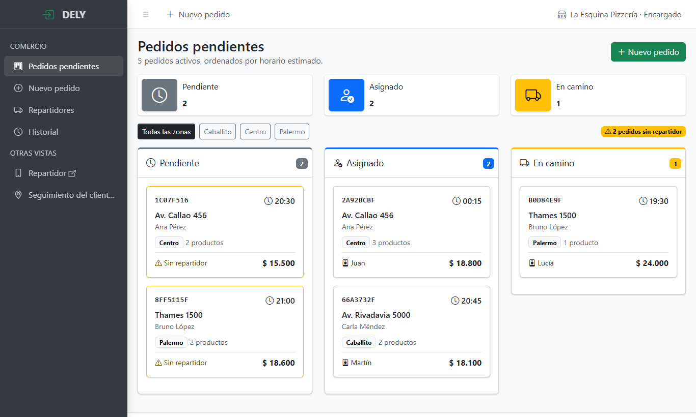
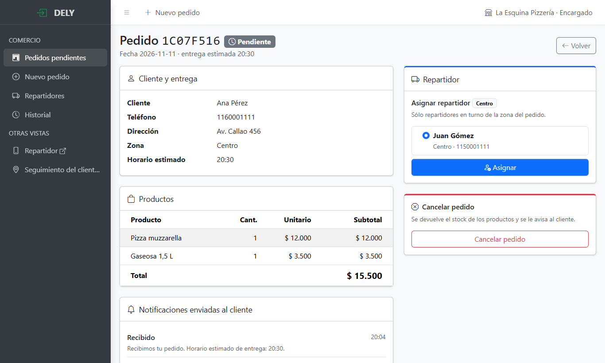
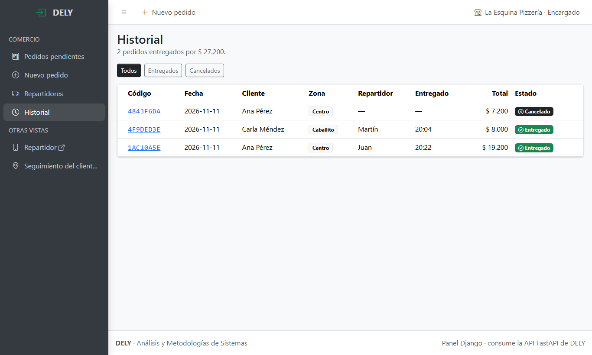

# DELY — Panel web del encargado (Django)

Panel del comercio hecho con **Django** y **AdminLTE 4**. No tiene base de datos propia: todos los datos los lee y los escribe a través de la API de DELY (`backend/`), usando `requests`. Es el mismo esquema que vimos en clase, con Django consumiendo una API FastAPI a partir de un `API_URL` definido en el `.env`.



## Preparar y ejecutar

Requiere Python 3.11 o superior y **la API corriendo** (ver [backend/README.md](../backend/README.md)). Todos los comandos se corren desde `web/`.

```powershell
cd web
py -m venv .venv
.\.venv\Scripts\python.exe -m pip install -r requirements.txt
Copy-Item .env.example .env
.\.venv\Scripts\python.exe manage.py runserver 8001
```

Abrí <http://127.0.0.1:8001>. Se usa el puerto 8001 porque la API ocupa el 8000.

| Variable (`.env`) | Para qué sirve |
|---|---|
| `API_URL` | URL base de la API, por ejemplo `http://127.0.0.1:8000/api/` |
| `FRONTEND_URL` | Front React con las vistas del repartidor y del cliente (links del menú) |
| `SECRET_KEY`, `DEBUG`, `ALLOWED_HOSTS` | Configuración estándar de Django |

### Tests

```powershell
.\.venv\Scripts\python.exe manage.py test
```

Los tests simulan las respuestas de la API, así que no hace falta tenerla corriendo.

## Arquitectura (MVC)

| Capa | Archivos | Rol |
|---|---|---|
| Modelo | `panel/src/services.py` | Acceso a los datos: una función por endpoint de la API, con `requests`. Traduce los errores de la API a `ErrorApi`. |
| Vista | `panel/templates/` | Templates de Django con AdminLTE 4, Bootstrap 5 y Bootstrap Icons |
| Controlador | `panel/controllers/` | Vistas basadas en clase (`View` con `get` y `post`): reciben el pedido, llaman a los servicios y eligen el template |

```
web/
├── manage.py
├── requirements.txt
├── .env.example
└── panel/
    ├── settings.py          Configuración (lee API_URL del .env)
    ├── urls.py              Rutas → controladores
    ├── context_processors.py
    ├── controllers/         pedidos, repartidores e historial
    ├── src/services.py      Cliente de la API con requests
    ├── templates/           base.html (layout AdminLTE) y una pantalla por ruta
    ├── templatetags/dely.py Filtros: pesos, hora y color/icono por estado
    └── tests.py
```

**¿Por qué no hay modelos de Django ni migraciones?** Porque la base de datos ya la maneja la API con SQLAlchemy. Si Django también definiera las tablas, habría dos ORM escribiendo sobre las mismas tablas y las reglas de negocio (stock, estados, notificaciones) se podrían saltear. El panel siempre pasa por la API.

## Pantallas

| Ruta | Pantalla | HU |
|---|---|---|
| `/pedidos/` | Pedidos activos en columnas por estado, filtro por zona y aviso de pedidos sin repartidor | HU-01 |
| `/pedidos/<id>/` | Detalle: cliente, productos, notificaciones enviadas, **asignación del repartidor** y cancelación | HU-02 |
| `/pedidos/nuevo/` | Carga de un pedido: cliente, zona, horario y productos, con el total calculado en vivo | — |
| `/repartidores/` | Repartidores por zona, con el botón para ponerlos en turno o sacarlos | HU-02 |
| `/historial/` | Pedidos entregados y cancelados, con lo facturado | — |

Las vistas del **repartidor** y del **cliente** están en el front React (`frontend/`), pensado para el celular. El menú del panel tiene links a esas vistas.

| Asignación de repartidor | Historial |
|---|---|
|  |  |
